<picture>
  <source media="(prefers-color-scheme: dark)" srcset="./assets/singularity-hero-dark.svg">
  
</picture>

<b>SAYAN BAIRAGI</b>

#### Telemetry

<picture>
  <source media="(prefers-color-scheme: dark)" srcset="./assets/singularity-telemetry-dark.svg">
  
</picture>

Reading the instruments

- **Accretion disk:** one particle per day of the last year; brighter and closer to the hole means a busier day. Inner rings orbit faster, as they would around a real black hole.
- **Orbit:** contributions per month, plotted as a closed trajectory; the beacon marks the busiest month.
- **Spectral composition:** language share by bytes across public repositories.
- **Light theme:** rendered as a photographic negative, the way astronomical survey plates were printed.

Artwork: original animated SVG, generated by README Templates · template: Singularity. Motion stops if your system asks for reduced motion.

#### Flight log

- `MSN-01` **[xpdf](https://github.com/sayanmona1/xpdf)**  
  JavaScript
- `MSN-02` **[bot](https://github.com/sayanmona1/bot)**  
  JavaScript
- `MSN-03` **[FRIDAY-LAB-31-07-26-](https://github.com/sayanmona1/FRIDAY-LAB-31-07-26-)**  
- `MSN-04` **[25](https://github.com/sayanmona1/25)**  
  C

<picture>
  <source media="(prefers-color-scheme: dark)" srcset="./assets/singularity-end-dark.svg">
  
</picture>

